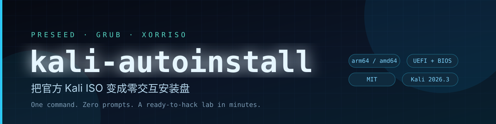

<p align="center">
  
</p>

<p align="center">
  <a href="https://github.com/weihaoyang/kali-autoinstall/releases/latest"></a>
  
  
  
  
</p>

<p align="center">
  <b>English</b> · <a href="README.md">简体中文</a>
</p>

<h3 align="center">Turn the official Kali ISO into a zero-touch installer with one command</h3>

<p align="center">
  Language, keymap, network, partitioning, account, mirror, SSH, guest tools — all pre-seeded.<br>
  Boot it, walk away, come back to a ready-to-use Kali box.
</p>

---

## ⬇️ Prebuilt ISO

| Arch | Version | Credentials | Download |
|---|---|---|---|
| **arm64** (Apple Silicon / ARM VMs) | Kali 2026.3 | `kali` / `kali` | **[kali-auto-arm64.iso](https://github.com/weihaoyang/kali-autoinstall/releases/latest)** |

```bash
shasum -a 256 kali-auto-arm64.iso
# 3fd8a64010ffd1486727f78deab8f322be6527db3d93585084cfd71fb435f9b7
```

The prebuilt image partitions `/dev/sda`, uses the USTC mirror and installs Xfce.
Build your own in ~15 seconds to change any of that.

## 🤔 Why

Installing Kali means clicking through a dozen screens: language, locale, keymap,
hostname, domain, root password, user, timezone, partitioning, confirm, mirror,
proxy, tasksel, GRUB. One wrong click and you start over.

Kali's installer is Debian's, so `preseed` works. The catch:

- Kali customizes the preseed layout inside the ISO;
- language and keymap are asked **before** the preseed file is loaded;
- naive ISO edits break the UEFI boot record.

This project handles all three: **append preseed + patch GRUB kernel args + `xorriso` boot replay**.
The result keeps both UEFI and BIOS boot and the stock installer's full feature set.

## ✨ Features

| | |
|---|---|
| 🚀 **Zero-touch** | Boot → install → reboot, no keyboard input |
| 🧩 **Parameterized** | user, password, hostname, disk, mirror, timezone, desktop |
| 💿 **Dual boot** | `xorriso -boot_image any replay` preserves UEFI + BIOS |
| 🍎 **Apple Silicon** | arm64 image out of the box — no x86 emulation trap |
| 🔐 **Ready to connect** | `openssh-server`, `open-vm-tools`, `spice-vdagent` preinstalled |
| 🧰 **Optional toolchain** | `scripts/provision.sh` adds red-team + blue-team tools |
| 🪶 **No binaries** | scripts only; build from the official ISO in seconds |

## ⚡ Quick start

### A. Use the prebuilt ISO (arm64)

```bash
# 1. create an arm64 Linux VM (EFI, disk /dev/sda)
# 2. attach kali-auto-arm64.iso as CD
# 3. boot, then grab a coffee
ssh kali@<vm-ip>        # password: kali
```

### B. Build your own

```bash
brew install xorriso                 # macOS
# sudo apt install xorriso python3   # Debian / Ubuntu

git clone https://github.com/weihaoyang/kali-autoinstall.git
cd kali-autoinstall

./scripts/build-iso.sh \
  -i ~/Downloads/kali-linux-2026.3-installer-netinst-arm64.iso \
  -o kali-auto-arm64.iso
```

Output:

```text
[1/4] extracting config from the official ISO
[2/4] rendering preseed
[3/4] patching GRUB menu
[4/4] repacking ISO
Written to medium : 294528 sectors at LBA 32
完成: kali-auto-arm64.iso
```

## 🎛️ Options

| Flag | Default | Description |
|---|---|---|
| `-i, --iso` | — | official netinst ISO (required) |
| `-o, --out` | `kali-auto.iso` | output file |
| `--hostname` | `kali` | hostname |
| `--user` | `kali` | username |
| `--password` | `kali` | password |
| `--disk` | `/dev/sda` | target disk (`/dev/vda` for UTM/virtio) |
| `--mirror-host` | `mirrors.ustc.edu.cn` | apt mirror |
| `--mirror-dir` | `/kali` | mirror path |
| `--timezone` | `Asia/Shanghai` | timezone |
| `--desktop` | `kali-desktop-xfce` | desktop metapackage |
| `--country` | `CN` | country code |

## 🔬 How it works


1. **Append** after Kali's own preseed so later keys win.
2. **Kernel args** carry language/keymap because they are asked before preseed loads.
3. **`-boot_image any replay`** reuses the original El Torito boot, keeping UEFI intact.
4. **`auto=true priority=critical`** stops only on unanswered critical questions.

## 🖥️ Create the VM

### VMware Fusion (Apple Silicon) — one command

```bash
./scripts/fusion-quickstart.sh -i ~/VMs/kali-auto-arm64.iso
```

It creates the VM with `vmcli`, resizes the disk, writes a 4 vCPU / 8 GB EFI
`.vmx`, and starts it. Manual steps are in
[docs/apple-silicon-fusion.md](docs/apple-silicon-fusion.md).

> ⚠️ Apple Silicon runs **arm64** guests only. Kali's `-vmware-amd64.7z` is x86_64
> and will refuse to boot on M-series Macs — architecture, not freshness.

### UTM / libvirt / PVE

```bash
./scripts/build-iso.sh -i kali-...-arm64.iso -o kali-auto-arm64.iso --disk /dev/vda
```

### x86

Build from the amd64 netinst ISO; keep `--disk /dev/sda`.

## 🧰 Post-install (optional)

```bash
scp scripts/provision.sh kali@<vm-ip>:/tmp/
ssh kali@<vm-ip> "sudo bash /tmp/provision.sh"
```

Adds `kali-linux-large`, forensics/reporting metapackages, web/AD/password/wireless/
reverse-engineering/pwn/traffic-analysis tools, plus pipx tools such as
`volatility3`, `certipy` and `bloodhound.py`.

## 🧯 FAQ

<details>
<summary><b>It still asks for a language</b></summary>

The kernel args did not apply. The `linux` line must contain
`auto=true` and `language=en country=CN locale=en_US.UTF-8 keymap=us`.
</details>

<details>
<summary><b>Partitioning fails / no disk found</b></summary>

Match `--disk` to the virtual hardware: VMware SATA `/dev/sda`,
UTM/virtio `/dev/vda`, NVMe `/dev/nvme0n1`.
</details>

<details>
<summary><b>Package download is slow</b></summary>

Try `--mirror-host mirrors.tuna.tsinghua.edu.cn`, or point `--mirror-dir`
at an internal mirror.
</details>

<details>
<summary><b>Where is Zeek?</b></summary>

Kali's `zeek` package may depend on an older `glibc`. `provision.sh` suggests
the Docker route: `docker run --rm -v "$PWD:/pcap" zeek/zeek zeek -r x.pcap`.
</details>

## 🔐 Security

- The generated ISO **wipes the target disk**. Double-check `--disk`.
- `kali/kali` is for isolated lab use only — never expose it publicly.
- This repo ships scripts only. The Release ISO is rebuilt from the official
  netinst; Kali Linux is a trademark of OffSec Services Limited and every
  package keeps its own license.
- Use these tools only on systems you own or are explicitly authorized to test.

## 📄 License

[MIT](LICENSE) © 2026 weihaoyang
