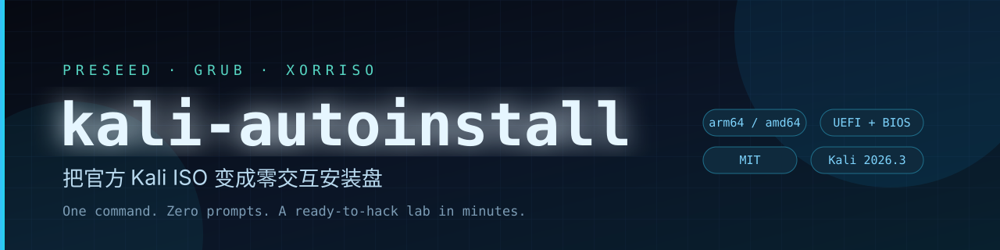
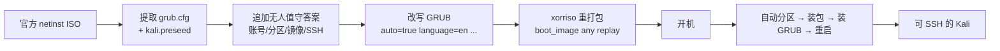

<p align="center">
  
</p>

<p align="center">
  <a href="https://github.com/weihaoyang/kali-autoinstall/releases/latest"></a>
  
  
  
  
</p>

<h3 align="center">一条命令，把 Kali 官方 ISO 变成零交互安装盘</h3>

<p align="center">
  语言、键盘、网络、分区、账号、镜像源、SSH、guest tools —— 全部预置。<br>
  开机后不用按一个键，十分钟得到一台可以直接开工的 Kali。
</p>

---

## ⬇️ 下载现成的 ISO

不想自己构建？直接下载 Release 里的成品（575 MB）：

| 架构 | 版本 | 默认账号 | 下载 |
|---|---|---|---|
| **arm64**（Apple Silicon / ARM 虚拟机） | Kali 2026.3 | `kali` / `kali` | **[kali-auto-arm64.iso](https://github.com/weihaoyang/kali-autoinstall/releases/latest)** |

```bash
# 下载后校验
shasum -a 256 kali-auto-arm64.iso
# 3fd8a64010ffd1486727f78deab8f322be6527db3d93585084cfd71fb435f9b7
```

> 成品盘按 `/dev/sda`（VMware / SATA）分区、使用中科大镜像、装 Xfce 桌面。
> 要改磁盘名/账号/镜像/桌面，用下面的一条命令自己构建，十几秒出盘。

---

## 🤔 为什么需要它

装一台 Kali 要过十几屏：语言、地区、键盘、主机名、域名、root 密码、用户、
时区、分区方案、确认写盘、镜像源、代理、软件选择、GRUB……任何一步点错就要重来。
批量做实验环境时，这套流程纯属浪费生命。

Kali 的 installer 本身基于 Debian，天生支持 `preseed`。问题在于：

- 官方 ISO 里的 preseed 是 Kali 定制过的，路径和普通 Debian 不一样；
- 语言/键盘在读取 preseed **之前**就会问，必须靠内核参数；
- 直接改 ISO 很容易破坏 UEFI 引导记录。

这个项目把这三件事一次性解决：**追加 preseed + 改写 GRUB 内核参数 + `xorriso` 原样重放引导**，
产出的 ISO 仍然同时支持 UEFI 和 BIOS，并且保留官方安装器的全部能力。

## ✨ 特性

| | |
|---|---|
| 🚀 **零交互** | 开机即装，装完自动重启，全程无需键盘 |
| 🧩 **参数化** | 用户名、密码、主机名、磁盘、镜像、时区、桌面环境全部可配 |
| 💿 **双引导** | `xorriso -boot_image any replay` 保留原盘 UEFI + BIOS 引导 |
| 🍎 **Apple Silicon** | 直接产出 arm64 自动安装盘，绕开“amd64 镜像在 M 系 Mac 上跑不了”的坑 |
| 🔐 **开箱可连** | 预装 `openssh-server`、`open-vm-tools`、`spice-vdagent` |
| 🧰 **可选工具链** | 附带 `provision.sh`，装完一键补齐红队 + 蓝队工具 |
| 🪶 **无二进制依赖** | 仓库只有脚本，十几秒从官方 ISO 现场构建 |

## ⚡ 快速开始

### 方式 A：用 Release 成品（arm64）

```bash
# 1. 新建一台 arm64 Linux 虚拟机（EFI，磁盘 /dev/sda）
# 2. 挂载 kali-auto-arm64.iso 为光驱
# 3. 开机，去泡杯咖啡
# 4. 回来后：
ssh kali@<vm-ip>        # 密码 kali
```

### 方式 B：自己构建（推荐，可定制）

```bash
# 依赖
brew install xorriso                 # macOS
# sudo apt install xorriso python3   # Debian / Ubuntu

git clone https://github.com/weihaoyang/kali-autoinstall.git
cd kali-autoinstall

./scripts/build-iso.sh \
  -i ~/Downloads/kali-linux-2026.3-installer-netinst-arm64.iso \
  -o kali-auto-arm64.iso
```

十几秒后得到 `kali-auto-arm64.iso`：

```text
[1/4] 从官方 ISO 提取配置
[2/4] 渲染 preseed
[3/4] 改写 GRUB 菜单
[4/4] 重新打包 ISO
Written to medium : 294528 sectors at LBA 32
d9d4ac14806507ff90ad880d6b3fa8b57356181c5f0bf1e30d276cb7425988c6  kali-auto-arm64.iso
完成: kali-auto-arm64.iso
用户名: kali  密码: kali  磁盘: /dev/sda
```

## 🎛️ 参数

```text
./scripts/build-iso.sh -i <官方 netinst ISO> [-o <输出 ISO>] [选项]
```

| 参数 | 默认值 | 说明 |
|---|---|---|
| `-i, --iso` | — | 官方 netinst ISO（必填） |
| `-o, --out` | `kali-auto.iso` | 输出文件 |
| `--hostname` | `kali` | 主机名 |
| `--user` | `kali` | 用户名 |
| `--password` | `kali` | 密码 |
| `--disk` | `/dev/sda` | 安装磁盘（UTM/virtio 用 `/dev/vda`） |
| `--mirror-host` | `mirrors.ustc.edu.cn` | apt 镜像域名 |
| `--mirror-dir` | `/kali` | 镜像路径 |
| `--timezone` | `Asia/Shanghai` | 时区 |
| `--desktop` | `kali-desktop-xfce` | 桌面元包（可换 `kali-desktop-kde` / `kali-desktop-gnome`） |
| `--country` | `CN` | 国家代码 |

## 🔬 工作原理



关键点：

1. **preseed 追加在 Kali 官方文件之后**，后写的键覆盖默认值，不会丢掉 Kali 的定制。
2. **语言/键盘必须走内核参数**（`language=en keymap=us`），因为它们比 preseed 加载得更早。
3. **`xorriso -boot_image any replay`** 复用原盘的 El Torito 引导，避免手搓 `mkisofs` 把 UEFI 搞坏。
4. **`auto=true priority=critical`** 让安装器只对关键问题停下来，其余全用 preseed 答案。

## 🖥️ 创建虚拟机

### VMware Fusion（Apple Silicon）

```bash
VMCLI="/Applications/VMware Fusion.app/Contents/Public/vmcli"

"$VMCLI" VM Create -n "Kali Linux" -d "$HOME/VMs/Fusion" -c arm-other5xlinux-64

VD="/Applications/VMware Fusion.app/Contents/Library/vmware-vdiskmanager"
"$VD" -x 80GB "$HOME/VMs/Fusion/Kali Linux.vmdk"
```

然后按 [docs/apple-silicon-fusion.md](docs/apple-silicon-fusion.md) 里的 `.vmx` 模板
配 4 vCPU / 8 GB / EFI / SATA 光驱 / vmxnet3 NAT，启动即可。

> ⚠️ **Apple Silicon 只能跑 arm64 客户机。** Kali 官网的 `-vmware-amd64.7z`
> 是 x86_64 镜像，在 M 系列 Mac 上开机会提示客户机操作系统不受支持——不是 Fusion 的问题，
> 也不是镜像不新，是架构不对。

### UTM / libvirt / PVE

磁盘设备是 `/dev/vda` 时：

```bash
./scripts/build-iso.sh -i kali-...-arm64.iso -o kali-auto-arm64.iso --disk /dev/vda
```

### x86（VMware / VirtualBox）

直接用 `amd64` 的官方 netinst ISO 构建，磁盘保持 `/dev/sda`。

## 🧰 装完之后（可选）

```bash
scp scripts/provision.sh kali@<vm-ip>:/tmp/
ssh kali@<vm-ip> "sudo bash /tmp/provision.sh"
```

包含：`kali-linux-large`、取证/报告元包、Web / AD / 口令 / 无线 / 逆向 / Pwn /
流量分析工具，以及 `volatility3`、`certipy`、`bloodhound.py` 等 pipx 工具。

## 🧯 常见问题

<details>
<summary><b>开机还是停在语言选择？</b></summary>

说明内核参数没生效：确认 `grub.cfg` 里的 `linux` 行同时包含
`auto=true` 和 `language=en country=CN locale=en_US.UTF-8 keymap=us`。
如果你手动改过 ISO，注意不要覆盖 `/boot/grub/grub.cfg` 的默认菜单项。
</details>

<details>
<summary><b>分区阶段失败 / 找不到磁盘？</b></summary>

`--disk` 必须和虚拟机里的设备名一致：VMware SATA 是 `/dev/sda`，
UTM/virtio 是 `/dev/vda`，NVMe 是 `/dev/nvme0n1`。
</details>

<details>
<summary><b>装到一半卡在下载软件包？</b></summary>

换个更近的镜像：`--mirror-host mirrors.tuna.tsinghua.edu.cn`。
企业内网可以用自建镜像，把 `--mirror-dir` 指向对应路径。
</details>

<details>
<summary><b>为什么没有 Zeek？</b></summary>

Kali 仓库里的 `zeek` 版本可能依赖旧 `glibc`，在新版系统上装不上。
`provision.sh` 里给出了 Docker 方案：`docker run --rm -v "$PWD:/pcap" zeek/zeek zeek -r x.pcap`。
</details>

## 🔐 安全声明

- 生成的 ISO 会**清空目标磁盘**，执行前确认 `--disk` 指向正确。
- 默认账号 `kali/kali` 只适合本地隔离实验环境，请勿直接暴露到公网。
- 本仓库只包含构建脚本；Release 中的 ISO 由官方 netinst 重制，
  Kali Linux 是 OffSec Services Limited 的商标，各软件包遵循其各自许可证。
- 请只在你自己拥有或获得明确授权的环境中使用这些工具。

## 🗺️ Roadmap

- [x] arm64 自动安装盘（Apple Silicon / VMware Fusion）
- [x] 参数化 preseed + GRUB 补丁
- [x] Release 成品 ISO
- [ ] Fusion 一键脚本（建 VM + 挂 ISO + 启动）
- [ ] 英文 README
- [ ] CI：每次 Kali 发版自动构建并校验

## 📄 License

[MIT](LICENSE) © 2026 weihaoyang
